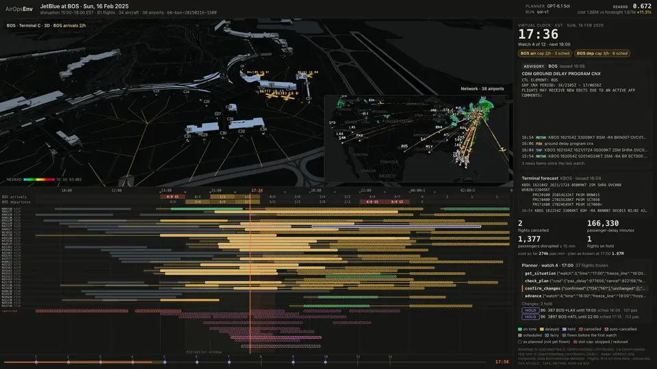
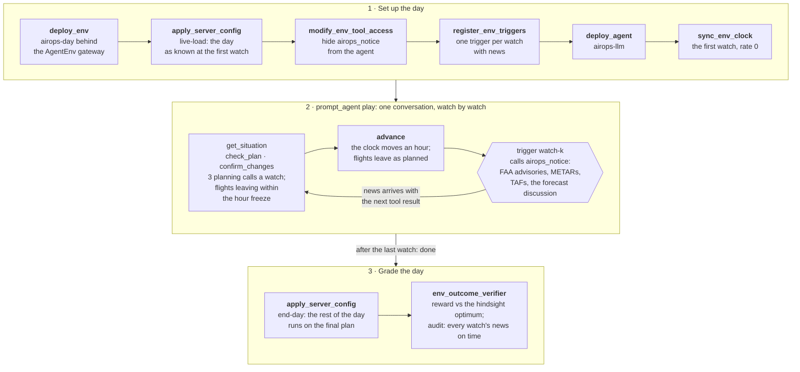

# AirOpsEnv for AgentEnv

[](https://www.agentenvframework.com)
[](NOTICE)
[](https://huggingface.co/datasets/earakely-scale/AirOpsEnv-AgentEnv)
[](https://huggingface.co/spaces/earakely-scale/AirOpsEnv-AgentEnv)

<p align="center">
  <a href="https://github.com/earakely-scale/agentenv-airops-plugin/releases/tag/v0.1.0"></a>
</p>
<p align="center"><sub>GPT-6.1 Sol runs JetBlue's Boston desk through the storm of Sunday 16 February 2025 (<code>b6-bos-20250216-1500</code>): 81 flights to 38 airports, 12 hourly watches on AgentEnv's virtual clock. The FAA Command Center's ground delay program, three ground stops and their cancellations reach it as they were issued, with 8 TAFs and 21 METARs. In 21 planning calls it cancels and holds flights; the day, flown on what really happened, costs 11.3% more than the plan a MIP proves optimal in hindsight: reward 0.672. The re-planning reference scores 0.937, doing nothing 0.366 and JetBlue's own decisions that day 0.224. Replayed on the env's viewer; <a href="https://github.com/earakely-scale/agentenv-airops-plugin/releases/tag/v0.1.0">full film</a>. Basemap © OpenStreetMap contributors via OpenFreeMap; hub twin © OpenStreetMap contributors (ODbL); radar NEXRAD n0q via the Iowa Environmental Mesonet.</sub></p>

An agent runs the JetBlue operations desk at one of its hubs, JFK or Boston, on a real day that went wrong:
thunderstorms, snow or wind, and the FAA ground stops and ground delay programs that followed, cut how many JetBlue
flights could land and take off each hour. Watch by watch, on AgentEnv's virtual clock, it cancels, restores and holds
flights so that passengers lose as little time as possible. The FAA Command Center's advisories, the hub's METARs and
TAFs and the forecasters' discussion reach it as they were issued; each flight's delay and each hour's slot cap
become known as they would have. After the last watch the plan is flown on the day as it really happened and graded,
with no judge, against the plan a MIP solver proves optimal in hindsight.

Everything comes from public U.S. records: BTS on-time, T-100 and Form 41 data, the FAA registry, the FAA Command
Center's advisories, and NWS products archived by the Iowa Environmental Mesonet. [DESIGN.md](DESIGN.md) is the
contract between the modules; this file tells you how to run it.

<details open>
<summary><b>How a day is played</b>: the task's steps, and the watch loop inside <code>play</code></summary>



</details>

## Run it yourself

You need Docker (running, with buildx), [uv](https://docs.astral.sh/uv/) and git. Install the plugin with the
framework, build the env and agent images and register them, and check the wiring with a task that calls no model:

```bash
uv tool install agentenv-framework \
    --with "agentenv-airops @ git+https://github.com/earakely-scale/agentenv-airops-plugin@v0.1.0"
agent-env airops setup --agent        # builds airops-day and airops-llm for this machine's Docker
agent-env run airops --task wiring-noplay
```

`wiring-noplay` deploys the env, loads the first eval day, registers its triggers and arms the clock, then ends the
day without an agent: the env delivers every watch's news itself, the day flies with no change (the naive
reference) and the verifier scores it. Then play a day with a model on the endpoint `[model]` in
`.agentenv/config.toml` names (LiteLLM, or the Hugging Face router):

```bash
agent-env run airops --task b6-bos-20250216-1500 --model openai/gpt-6.1-sol
```

From a checkout, `uv sync --extra dev --extra viewer` (or `pip install -e '.[dev,viewer]'`) and the same commands.
`--platform linux/amd64` on `setup` builds for remote sandboxes.

## The day

A task is one hub window on a real day of the pack `b6-v1` (JetBlue, JFK and Boston), built from 13 months of 2022 to
2025: 20 eval days, 3 control days (no cancellation in scope) and 34 training days, with 59 to 194 flights on 30 to 59
aircraft and 10 to 22 watches. The eval days span 7 months of thunderstorms and winter storms, 12 at JFK and 8 at
Boston. Each day's window is the 3 to 6 hours where planning matters most: the largest gap between doing nothing and
the hindsight optimum, among windows where every flight has its aircraft, weather and air traffic control caused at
least 80% of the cancellations, and 30 to 80 aircraft are in play. An eval day also needs doing nothing to cost at
least 10% over the optimum, the follower to land within 15% of it, and the optimum proven within 60 seconds.

- **Watches.** The first watch is an hour before the disruption window; a watch every hour after it, until every delay
  and cap is known (or no flight is left to decide). Time only passes when the planner calls `advance`.
- **Tools.** `get_situation()` gives the time, the freeze line, the slot caps as known for the next 8 hours, the FAA
  programs in effect, the latest METAR and TAF, every flight (its status, its delay once known, the plan, where the
  plan has it leave and land on the day as known, the aircraft it takes) and where the aircraft are.
  `check_plan(changes)` runs changes over the plan on the day as known without committing them;
  `confirm_changes(changes)` commits them. Both use one of the watch's 3 planning calls. `advance()` ends the watch.
  A change is `{"flight": "f12", "action": "cancel" | "restore" | "hold", "not_before": "HH:MM" | null}`, every field
  required and `not_before` nullable, so the schemas pass OpenAI's strict mode.
- **What the desk knows.** A flight's own delay (anything but waiting for its aircraft) is known 2 hours before its
  scheduled departure, assumed zero before. An hour's slot cap at an airport is known 4 hours ahead; before that
  JetBlue's own schedule for the hour stands in. News arrives at the first watch at or after it was issued.
- **The freeze.** Nothing is frozen at the first watch. From the second on, flights the plan has leaving before the
  freeze line, an hour after the watch, are frozen and stay frozen; the env refuses changes to them, and holds any
  other flight the plan would have leaving before the line to it (`held_to_freeze_line`), so no decision reaches back
  past it.
- **Execution.** The env dispatches the aircraft: a flight takes the first-ready aircraft of its family at its
  origin, leaves when its delay, its hold, the aircraft's turn and both hours' caps allow, and is cancelled if it
  can't leave within 6 hours of its schedule. At the end of the day aircraft are ferried to where tomorrow needs
  them.

## Grading

The final plan is flown on the truth (`core.sim.execute`). Its cost, in passenger-minutes, is each passenger's
arrival delay, plus 523 per passenger on a cancelled flight, plus the ferries. The reward is
0.2 + 0.8 exp(−g/0.5), g = max(0, cost − anchor) / (anchor − floor + 0.02 anchor): 1.0 at the anchor, the hindsight
optimum, and never below 0.2, since the env never strands a flight. A day that never finished or whose news broke the
reveal schedule fails the verifier and is not scored.

| Reference | What it is |
|---|---|
| floor | the time-line MIP without aircraft routing: each flight alone at its earliest time under the caps |
| hindsight (anchor) | the time-line MIP (HiGHS, 1-minute arcs) on the truth, proven to 0.01% |
| follower | the MIP re-solved at every watch on the day as known (persistence forecast of unknown delays and caps), freezing as the env does, its final plan flown on the truth |
| blind | the follower with no forecast |
| naive | the empty plan: every flight as early as it can |
| airline | JetBlue's own cancellations and departure times as the plan (shown, never the anchor) |

`scripts/references.py` computes them into each task line; a day without them can be played but not scored. The
follower's watch solves prove their optimum and then pick, among the optimal plans, the one with the earliest weighted
departures, so the references come out the same on every run and machine.

## Results

GPT-6.1 Sol on 5 eval days, one run each through the real DAG on local Docker (`sol-v1`, $2.99 in all). Every run
finished, passed the verifier's audit, and replays byte for byte through the env's day.

| Day | Flights | Watches | GPT-6.1 Sol | Follower | Blind follower | Doing nothing | JetBlue |
|---|---:|---:|---:|---:|---:|---:|---:|
| `b6-bos-20250216-1500` | 81 | 12 | **0.672** | 0.937 | 0.937 | 0.366 | 0.224 |
| `b6-jfk-20230714-1400` | 91 | 13 | **0.441** | 0.782 | 0.229 | 0.212 | 0.200 |
| `b6-jfk-20240804-0700` | 149 | 20 | **0.382** | 0.901 | 0.627 | 0.213 | 0.202 |
| `b6-jfk-20250709-1500` | 76 | 12 | **0.324** | 0.614 | 0.743 | 0.224 | 0.200 |
| `b6-bos-20240107-0600` | 188 | 19 | **0.276** | 0.417 | 0.436 | 0.220 | 0.202 |
| **Mean** | | | **0.419** | 0.730 | 0.594 | 0.247 | 0.206 |

Sol beats doing nothing and JetBlue's own decisions on every day, and stays well below the re-planning reference: on
average its day costs 18.9% over the hindsight optimum. JetBlue's real day scores near the floor of the reward because
it cancelled far more than the passenger-centric cost favours, with crews and information this model leaves out; it is
shown, never the anchor. One run per day, so these are a first look, not a board.

## Play a model: sweeps

A sweep plays models over days, k reps each, one `agent-env run` per attempt, under a spend cap:

```bash
agent-env airops sweep run --name pilot --models anthropic/claude-sonnet-5-5,openai/gpt-6.1-sol \
    --tasks eval --k 1 --episode-cap-usd 2 --cap-usd 50 --parallel 4
agent-env airops sweep report pilot           # results/airops.md
```

- `--tasks` is `eval`, `control`, `train`, `all` (fewest watches first, so a spend stop drops the longest days) or
  comma-separated task ids; `--pack` points at another pack, which must be the one the env image holds.
- Each attempt is a row of `results/runs/<name>/results.jsonl`: the outcome, the verifier's reward, the day's cost and
  counts, the agent's end reason, turns, tool calls, tokens, spend and the cost of its priced tokens; its transcript
  goes to `transcripts/` and its log to `logs/`.
- An attempt that fails is retried up to twice; one stopped at its episode cap or refused by the provider is final. No
  attempt starts that could take the spend past `--cap-usd` with every running attempt at its cap, and an attempt that
  recorded no spend counts at the cap. A missing model endpoint or price stops new attempts. Running the sweep again
  plays the runs that aren't final; Ctrl-C tears the running attempts down.
- The report gives each model's mean reward over days (a day's value is the mean of its reps) with a 95% bootstrap CI,
  next to the follower's, the blind follower's, naive's and the airline's rewards on the same days, then a table per
  day, the unscored runs and the runs whose agent reward differs from the verifier's.

## Watch a run

```bash
agent-env airops view sol-v1                  # http://127.0.0.1:8238/web/
agent-env airops record sol-v1 --task b6-bos-20250216-1500 --out cache/films/sol.mp4 --cut 1020:hub
```

`view` replays every scored run of the sweeps through the env's day (`agentenv_airops.episodes`): each recorded tool
call is played back in order and its output checked byte for byte against the recording, the watch's news delivered
after its advance as the triggers deliver it. A run that doesn't replay (recorded before the env changed) is listed and
left out. Each replay is exported as the viewer's Episode JSON (`agentenv_airops.export`, `web/episode.schema.json`):
the schedule, the final plan flown on the truth, each watch as the desk knew it (its news, the caps, the changes, the
plan's cost on the day as known), the tool calls, the truth's caps, the NEXRAD radar frames
(`scripts/prebake_radar.py`) and the hub's OpenStreetMap twin (`scripts/build_twin.py`) when they are in `cache/`.
`record` films one with the checkout's `scripts/record.py` (headless Chrome and ffmpeg).

`scripts/fixture_episode.py` makes the same episode for the follower: its per-watch plans played through the env's
tools and exported, under `cache/episodes/`.

## The dataset and the Space

`scripts/hub_dataset.py` builds [earakely-scale/AirOpsEnv-AgentEnv](https://huggingface.co/datasets/earakely-scale/AirOpsEnv-AgentEnv)
from the pack and the sweeps under `results/runs`: the days, their references and the scored runs per split, the model
board and its eval card (`results/eval-v1.json`), agentenv-hf's tables and the bundle `airops` so that
`agent-env hf run earakely-scale/AirOpsEnv-AgentEnv` plays a day, the viewer's episodes with their radar and twins
under `viewer/`, and the raw sweeps under `runs/`. agentenv-hf scans every file for keys and token shapes first.

```bash
python scripts/hub_dataset.py sol-v1 --out cache/hub/dataset --space-out cache/hub/space
python scripts/hub_dataset.py sol-v1 --out cache/hub/dataset --repo earakely-scale/AirOpsEnv-AgentEnv --tag v0.1.0
```

The [replay Space](https://huggingface.co/spaces/earakely-scale/AirOpsEnv-AgentEnv) is static: `hub/space/` and the
viewer (`web/`) under `viewer/`, reading the episodes straight from the dataset's resolve URLs at the tag, which
huggingface.co serves with CORS headers. `--space-out` assembles it and `--space-repo` pushes it.

## v1 simplifications and assumptions

AirOpsEnv v1 is a model of a day, not an airline's operations system. What it leaves out or assumes:

- **One airline, two hubs, one window.** Only JetBlue's flights touching JFK or Boston in a 3 to 6 hour window
  (and the rest of the day of the aircraft that fly them) are in play. Other carriers appear only through the caps.
- **Caps are a share, not the FAA's rate.** An hour's cap is JetBlue's ration-by-schedule share of the movements all
  carriers actually made at the airport, never below what JetBlue's in-scope flights moved there. The truth caps are
  what happened under the airline's own decisions; a different plan would not have changed them.
- **Delays are exogenous.** A flight's own delay is its departure delay less the late-aircraft part; a cancelled
  flight gets the 75th percentile of its neighbours'. Before it is known, the desk sees no delay at all.
- **Aircraft are interchangeable within a family at an airport.** No tail pinning, crews, maintenance, gates or
  curfews; turn times are each family's 5th percentile of the day's observed turns.
- **Passengers are counts.** Load factors from T-100, no connections or rebooking: a cancelled passenger costs a flat
  523 minutes (NEXTOR's average re-accommodation delay plus refund exposure at the FAA's value of time), and a ferry
  92 × (30 + miles / 8), an assumed block time at A4A's cost per block minute.
- **Diversions count as cancellations** in the airline's day; the env has no diversions.
- **The freeze-line hold** (above) is the env's, not DESIGN.md's: without it a planner could hold a flight past the
  line and release it once the truth is known.
- **The weather is text.** The planner reads METARs, TAFs, the forecast discussion and the FAA's advisories; the radar
  in the viewer is for people.
- **The anchor is hindsight.** It knows every delay and cap in advance, so 1.0 is out of reach online; the follower,
  re-planning on the day as known, is the online reference. No excuse is given for news after a flight's freeze.

## Repository

| Path | What |
|---|---|
| `src/agentenv_airops/core/` | the model, the execution, the cost, the reward, what is known when |
| `src/agentenv_airops/refs/` | the time-line MIP, the follower, naive and the airline |
| `src/agentenv_airops/build/`, `scripts/build_pack.py` | the data pack builder (BTS, FAA, IEM), `data/b6-v1/` with each source's `SOURCE.md` |
| `src/agentenv_airops/{day,live,server,schedule}.py` | the live env `airops-day`: one day, its tools, extensions and triggers |
| `src/agentenv_airops/tasks.py`, `bundles/airops/` | the task DAG, the bundle and the verifier |
| `agents/airops-llm/` | the planner harness on Anthropic Messages, OpenAI Responses and OpenAI-compatible chat |
| `src/agentenv_airops/{sweep,episodes,export,view,record}.py` | sweeps, replay, the Episode JSON, the viewer server, filming |
| `web/` | the viewer (MapLibre and deck.gl) |
| `scripts/hub_dataset.py`, `hub/` | the Hugging Face dataset and the static Space |

```bash
uv sync --extra dev --extra viewer --extra build
pytest                                   # offline; -m docker, -m browser and -m network run the rest
PYTHONPATH=tests python scripts/live_e2e.py   # a zero-spend day through the real DAG on local Docker
```

## Licence and attribution

Code: Apache-2.0 ([LICENSE](LICENSE)). The data: BTS, FAA and NWS records are U.S. Government works in the public
domain; the Iowa Environmental Mesonet archives the METARs, TAFs, forecast discussions and NEXRAD composites (public
domain; attribution appreciated, and given); airport names, coordinates and time zones come from airportsdata (MIT).
The hub twins are © OpenStreetMap contributors (ODbL 1.0), built into `cache/twin/` and never committed. See
[NOTICE](NOTICE) and each `data/*/sources/*/SOURCE.md`. Neither JetBlue, the FAA, the BTS, the NWS nor the IEM is
affiliated with this project or endorses it.
