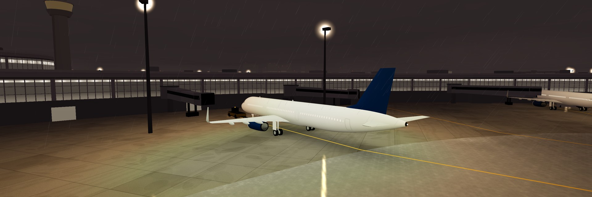
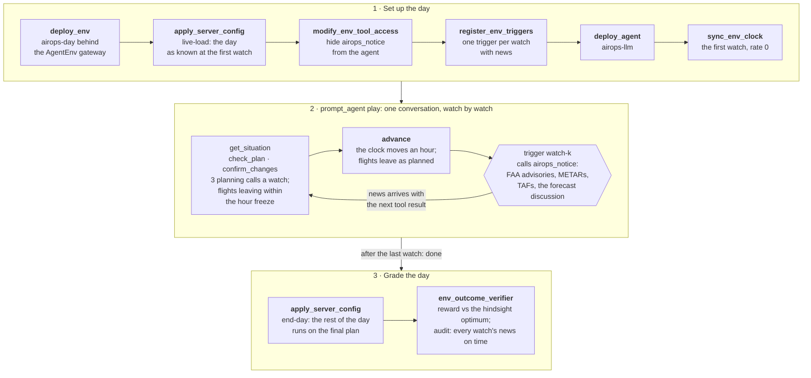

<div align="center">

<a href="https://huggingface.co/spaces/earakely-scale/AirOpsEnv-AgentEnv"></a>

<h1>AirOpsEnv v1</h1>

<h3>Recover an airline's storm day at JFK or Boston</h3>

<p>An AgentEnv environment built from public U.S. flight, FAA and weather records, graded with no judge against the plan a MIP proves optimal in hindsight.</p>

<a href="https://huggingface.co/spaces/earakely-scale/AirOpsEnv-AgentEnv"></a>
<a href="https://huggingface.co/datasets/earakely-scale/AirOpsEnv-AgentEnv"></a>
<a href="https://github.com/earakely-scale/agentenv-airops-plugin"></a>
<a href="https://www.agentenvframework.com"></a>

</div>

---

## The task

An agent runs the JetBlue operations desk at one of its hubs, JFK or Boston, on a real day that went wrong:
thunderstorms, snow or wind, and the FAA ground stops and ground delay programs that followed, cut how many JetBlue
flights could land and take off each hour. Watch by watch, on AgentEnv's virtual clock, it cancels, restores and holds
flights so that passengers lose as little time as possible. The FAA Command Center's advisories, the hub's METARs and
TAFs and the forecasters' discussion reach it as they were issued; each flight's delay and each hour's slot cap
become known as they would have. After the last watch the plan is flown on the day as it really happened and graded,
with no judge, against the plan a MIP solver proves optimal in hindsight.

| tool | what it does |
|---|---|
| `get_situation()` | the time, the freeze line, the slot caps as known for the next 8 hours, the FAA programs in effect, the latest METAR and TAF, every flight (its status, its delay once known, the plan, where the plan has it leave and land on the day as known, the aircraft it takes) and where the aircraft are |
| `check_plan(changes)` | runs changes over the plan on the day as known without committing them; one of the watch's 3 planning calls |
| `confirm_changes(changes)` | commits them; also one of the watch's 3 planning calls |
| `advance()` | ends the watch: the clock moves an hour and flights leave as planned |

A change is `{"flight": "f12", "action": "cancel" | "restore" | "hold", "not_before": "HH:MM" | null}`, every field
required and `not_before` nullable, so the schemas pass OpenAI's strict mode.

- **Watches.** The first watch is an hour before the disruption window; a watch every hour after it, until every delay
  and cap is known (or no flight is left to decide). Time only passes when the planner calls `advance`.
- **What the desk knows.** A flight's own delay (anything but waiting for its aircraft) is known 2 hours before its
  scheduled departure, assumed zero before. An hour's slot cap at an airport is known 4 hours ahead; before that
  JetBlue's own schedule for the hour stands in. News arrives at the first watch at or after it was issued.
- **The freeze.** Nothing is frozen at the first watch. From the second on, flights the plan has leaving before the
  freeze line, an hour after the watch, are frozen and stay frozen; the env refuses changes to them, and holds any
  other flight the plan would have leaving before the line to it (`held_to_freeze_line`), so no decision reaches back
  past it.
- **Execution.** The env dispatches the aircraft: a flight takes the first-ready aircraft of its family at its
  origin, leaves when its delay, its hold, the aircraft's turn and both hours' caps allow, and is cancelled if it
  can't leave within 6 hours of its schedule. At the end of the day aircraft are ferried to where tomorrow needs
  them.

<details open>
<summary><b>How a day is played</b>: the task's steps, and the watch loop inside <code>play</code></summary>



</details>

## The data

A task is one hub window on a real day of the pack `b6-v1` (JetBlue, JFK and Boston), built from 13 months of 2022 to
2025: 20 eval days, 3 control days (no cancellation in scope) and 34 training days, with 59 to 194 flights on 30 to 59
aircraft and 10 to 22 watches. The eval days span 7 months of thunderstorms and winter storms, 12 at JFK and 8 at
Boston. Each day's window is the 3 to 6 hours where planning matters most: the largest gap between doing nothing and
the hindsight optimum, among windows where every flight has its aircraft, weather and air traffic control caused at
least 80% of the cancellations, and 30 to 80 aircraft are in play. An eval day also needs doing nothing to cost at
least 10% over the optimum, the follower to land within 15% of it, and the optimum proven within 60 seconds.

Everything comes from public U.S. records: the flights, tails and delays from BTS on-time data, passengers from T-100,
aircraft from the FAA registry and Form 41, the FAA Command Center's advisories, and the METARs, TAFs and forecast
discussions archived by the Iowa Environmental Mesonet. `scripts/build_pack.py` builds the pack into `data/b6-v1/`,
where each source has its `SOURCE.md`; [DESIGN.md](DESIGN.md) is the contract between the modules.

## Grading

The final plan is flown on the truth (`core.sim.execute`). Its cost, in passenger-minutes, is each passenger's
arrival delay, plus 523 per passenger on a cancelled flight, plus the ferries. The reward is
0.2 + 0.8 exp(−g/0.5), g = max(0, cost − anchor) / (anchor − floor + 0.02 anchor): 1.0 at the anchor, the hindsight
optimum, and never below 0.2, since the env never strands a flight. A day that never finished or whose news broke the
reveal schedule fails the verifier and is not scored.

| Reference | What it is |
|---|---|
| floor | the time-line MIP without aircraft routing: each flight alone at its earliest time under the caps |
| hindsight (anchor) | the time-line MIP (HiGHS, 1-minute arcs) on the truth, proven to 0.01% |
| follower | the MIP re-solved at every watch on the day as known (persistence forecast of unknown delays and caps), freezing as the env does, its final plan flown on the truth |
| blind | the follower with no forecast |
| naive | the empty plan: every flight as early as it can |
| airline | JetBlue's own cancellations and departure times as the plan (shown, never the anchor) |

`scripts/references.py` computes them into each task line; a day without them can be played but not scored. The
follower's watch solves prove their optimum and then pick, among the optimal plans, the one with the earliest weighted
departures, so the references come out the same on every run and machine.

## Results

GPT-6.1 Sol on 5 eval days, one run each through the real DAG on local Docker (`sol-v1`, $2.99 in all). Every run
finished, passed the verifier's audit, and replays byte for byte through the env's day; each replays in 3D in the
[Space](https://huggingface.co/spaces/earakely-scale/AirOpsEnv-AgentEnv).

| Day | Flights | Watches | GPT-6.1 Sol | Follower | Blind follower | Doing nothing | JetBlue |
|---|---:|---:|---:|---:|---:|---:|---:|
| `b6-bos-20250216-1500` | 81 | 12 | **0.672** | 0.937 | 0.937 | 0.366 | 0.224 |
| `b6-jfk-20230714-1400` | 91 | 13 | **0.441** | 0.782 | 0.229 | 0.212 | 0.200 |
| `b6-jfk-20240804-0700` | 149 | 20 | **0.382** | 0.901 | 0.627 | 0.213 | 0.202 |
| `b6-jfk-20250709-1500` | 76 | 12 | **0.324** | 0.614 | 0.743 | 0.224 | 0.200 |
| `b6-bos-20240107-0600` | 188 | 19 | **0.276** | 0.417 | 0.436 | 0.220 | 0.202 |
| **Mean** | | | **0.419** | 0.730 | 0.594 | 0.247 | 0.206 |

Sol beats doing nothing and JetBlue's own decisions on every day, and stays well below the re-planning reference: on
average its day costs 18.9% over the hindsight optimum. JetBlue's real day scores near the floor of the reward because
it cancelled far more than the passenger-centric cost favours, with crews and information this model leaves out; it is
shown, never the anchor. One run per day, so these are a first look, not a board.

## Watch a run

<p align="center">
  <a href="https://github.com/earakely-scale/agentenv-airops-plugin/releases/tag/v0.2.0"></a>
</p>
<p align="center"><sub>GPT-6.1 Sol runs JetBlue's Boston desk through the storm of Sunday 16 February 2025 (<code>b6-bos-20250216-1500</code>): 81 flights to 38 airports, 12 hourly watches on AgentEnv's virtual clock. The FAA Command Center's ground delay program, three ground stops and their cancellations reach it as they were issued, with 8 TAFs and 21 METARs. In 21 planning calls it cancels and holds flights; the day, flown on what really happened, costs 11.3% more than the plan a MIP proves optimal in hindsight: reward 0.672. The re-planning reference scores 0.937, doing nothing 0.366 and JetBlue's own decisions that day 0.224. Replayed on the env's viewer; <a href="https://github.com/earakely-scale/agentenv-airops-plugin/releases/tag/v0.2.0">full film</a>. Airport © OpenStreetMap contributors (ODbL), imagery USGS The National Map; flights BTS; weather NWS and NEXRAD via the Iowa Environmental Mesonet.</sub></p>

The viewer replays a recorded run on the day it was played, from its first watch to the end of the day's activity at
the hub, often past midnight:

- **The airport in 3D** fills the screen: Boston Logan or JFK modelled from OpenStreetMap (runways, taxiways, aprons,
  stands, terminals, jet bridges, the tower) over USGS aerial photos of the land around, with Boston Harbor or Jamaica
  Bay as water. The sun follows the clock and the weather follows the hub's METARs: rain, snow, drizzle, mist and the
  cloud deck. Every airline's flights at the hub land, taxi and take off on their real BTS times, other airlines'
  aircraft in neutral grey; JetBlue's are white with a navy tail. The task's aircraft follow the agent's plan, not
  JetBlue's day, and carry tags: the flight, where it goes or comes from, and whether it is on time, delayed, held or
  cancelled (a cancelled flight's aircraft stays at its stand). JetBlue aircraft outside the task fly their real times,
  untagged. The camera watches from the tower, a gate, a runway threshold or across the water, or follows an aircraft
  you click.
- **The US map** sits in a corner: the NEXRAD radar and the aircraft in the air. Click it to swap it with the airport.
- **The departures board** lists the task's flights at the hub as the plan has them.
- **The desk** tells each watch in plain English: the FAA's programs, the weather, what the agent changed and what the
  day as known now costs. A model's own words appear when its transcript has them; Sol's runs are tool calls only.
- **Expert mode** shows the desk as the agent saw it: the advisories, METARs and TAFs as issued, the slot caps, and
  every tool call with its arguments and result.

The stands, the taxi routes and the runway in use are the viewer's inferences, for display only: BTS records none of
them, and neither the env nor the grade sees them.

```bash
agent-env airops view sol-v1                  # http://127.0.0.1:8238/web/
agent-env airops record sol-v1 --task b6-bos-20250216-1500 --director --seconds 66 \
    --out cache/films/sol.mp4 --webp cache/films/sol.webp
```

`view` replays every scored run of the sweeps through the env's day (`agentenv_airops.episodes`): each recorded tool
call is played back in order and its output checked byte for byte against the recording, the watch's news delivered
after its advance as the triggers deliver it. A run that doesn't replay (recorded before the env changed) is listed and
left out. Each replay is exported as the viewer's Episode JSON (`agentenv_airops.export`, `web/episode.schema.json`):
the schedule, the final plan flown on the truth, each watch as the desk knew it (its news, the caps, the changes, the
plan's cost on the day as known), the tool calls and the truth's caps; and, when they are in `cache/`, the hub's 3D
stage (`scripts/build_stage.py BOS JFK`, with the `build` extra) with the day's traffic, the NEXRAD radar frames
(`scripts/prebake_radar.py`) and the hub's OpenStreetMap twin (`scripts/build_twin.py`). The traffic
(`scripts/prebake_traffic.py --sweep sol-v1`) is every airline's movements at the hub on their real times, from the
BTS on-time data and the FAA registry that `scripts/build_pack.py` downloads into `cache/inputs/`; each episode gets
it as a sidecar with the run's plan laid over it ([DESIGN.md](DESIGN.md#viewer) gives its format). `record` films one
with the checkout's `scripts/record.py` (headless Chrome and ffmpeg). `--director` cuts the day into shots on the 3D
airport, in the order they happened: the hub across the water, the FAA's program reaching the desk, a decision landing
on the board, a held flight pushing back, taxiing and taking off, and the day's score; `--thumb` and `--still` write the
list's thumbnail and a frame without cards. `--rollout` films every watch instead, as PortSim's clip runs its week:
each opens on the desk with the model's planning calls and what it did, then the field moves on, then the score. The
dataset card's clip is `--rollout --camera '{"from": [-720, 780, 55], "at": [-770, 470, 4], "fov": 50} --size 1600x900
--webp-width 1024 --webp-fps 10 --webp-quality 60` on the Boston run. Without either, the clock sweeps the day watch by
watch on the map,
and `--cut MINUTE:VIEW` switches the camera to `tower`, `gate`, `threshold`, `harbour`, `follow` or `network` at a
minute of the day.

`scripts/fixture_episode.py` makes the same episode for the follower: its per-watch plans played through the env's
tools and exported, under `cache/episodes/`.

## Run it yourself

You need Docker (running, with buildx), [uv](https://docs.astral.sh/uv/) and git. Install the plugin with the
framework, build the env and agent images and register them, and check the wiring with a task that calls no model:

```bash
uv tool install agentenv-framework \
    --with "agentenv-airops @ git+https://github.com/earakely-scale/agentenv-airops-plugin@v0.2.0"
agent-env airops setup --agent        # builds airops-day and airops-llm for this machine's Docker
agent-env run airops --task wiring-noplay
```

`wiring-noplay` deploys the env, loads the first eval day, registers its triggers and arms the clock, then ends the
day without an agent: the env delivers every watch's news itself, the day flies with no change (the naive
reference) and the verifier scores it. Then play a day with a model on the endpoint `[model]` in
`.agentenv/config.toml` names (LiteLLM, or the Hugging Face router):

```bash
agent-env run airops --task b6-bos-20250216-1500 --model openai/gpt-6.1-sol
```

Or play one straight from the dataset, which pins this release:

```bash
agent-env hf run earakely-scale/AirOpsEnv-AgentEnv@v0.2.0 --task b6-bos-20250216-1500 \
    --model anthropic/claude-sonnet-5-5
```

`hf run` downloads the dataset card and `bundles/` at the tag's commit, checks that the plugin the card's `agentenv`
table names is installed, shows what it will run and asks first.

From a checkout, `uv sync --extra dev --extra viewer` (or `pip install -e '.[dev,viewer]'`) and the same commands.
`--platform linux/amd64` on `setup` builds for remote sandboxes.

### Sweeps

A sweep plays models over days, k reps each, one `agent-env run` per attempt, under a spend cap:

```bash
agent-env airops sweep run --name pilot --models anthropic/claude-sonnet-5-5,openai/gpt-6.1-sol \
    --tasks eval --k 1 --episode-cap-usd 2 --cap-usd 50 --parallel 4
agent-env airops sweep report pilot           # results/airops.md
```

- `--tasks` is `eval`, `control`, `train`, `all` (fewest watches first, so a spend stop drops the longest days) or
  comma-separated task ids; `--pack` points at another pack, which must be the one the env image holds.
- Each attempt is a row of `results/runs/<name>/results.jsonl`: the outcome, the verifier's reward, the day's cost and
  counts, the agent's end reason, turns, tool calls, tokens, spend and the cost of its priced tokens; its transcript
  goes to `transcripts/` and its log to `logs/`.
- An attempt that fails is retried up to twice; one stopped at its episode cap or refused by the provider is final. No
  attempt starts that could take the spend past `--cap-usd` with every running attempt at its cap, and an attempt that
  recorded no spend counts at the cap. A missing model endpoint or price stops new attempts. Running the sweep again
  plays the runs that aren't final; Ctrl-C tears the running attempts down.
- The report gives each model's mean reward over days (a day's value is the mean of its reps) with a 95% bootstrap CI,
  next to the follower's, the blind follower's, naive's and the airline's rewards on the same days, then a table per
  day, the unscored runs and the runs whose agent reward differs from the verifier's.

## The dataset and the Space

`scripts/hub_dataset.py` builds [earakely-scale/AirOpsEnv-AgentEnv](https://huggingface.co/datasets/earakely-scale/AirOpsEnv-AgentEnv)
from the pack and the sweeps under `results/runs`:

- the tables `v1_tasks` (the days, the default), `results` (the model board), `v1_references` and `v1_episodes` (the
  scored runs), a split per split of the pack, and the eval card `results/eval-v1.json`;
- agentenv-hf's tables `airops_tasks` and `airops_episodes` and the bundle `airops`, so that
  `agent-env hf run earakely-scale/AirOpsEnv-AgentEnv` plays a day;
- `viewer/`, the episodes as the viewer reads them, with their traffic, the airport stages, the radar frames, the hub
  twins and the films' stills; and `runs/`, the sweeps as they were recorded.

agentenv-hf scans every file for keys and token shapes first.

```bash
python scripts/hub_dataset.py sol-v1 --out cache/hub/dataset --space-out cache/hub/space
python scripts/hub_dataset.py sol-v1 --out cache/hub/dataset --repo earakely-scale/AirOpsEnv-AgentEnv --tag v0.2.0
```

The [replay Space](https://huggingface.co/spaces/earakely-scale/AirOpsEnv-AgentEnv) is static: `hub/space/` and the
viewer (`web/`) under `viewer/`, reading the episodes straight from the dataset's resolve URLs at the tag, which
huggingface.co serves with CORS headers. `--space-out` assembles it and `--space-repo` pushes it.

## Simplifications

AirOpsEnv v1 is a model of a day, not an airline's operations system. What it leaves out or assumes:

- **One airline, two hubs, one window.** Only JetBlue's flights touching JFK or Boston in a 3 to 6 hour window
  (and the rest of the day of the aircraft that fly them) are in play. Other carriers appear only through the caps.
- **Caps are a share, not the FAA's rate.** An hour's cap is JetBlue's ration-by-schedule share of the movements all
  carriers actually made at the airport, never below what JetBlue's in-scope flights moved there. The truth caps are
  what happened under the airline's own decisions; a different plan would not have changed them.
- **Delays are exogenous.** A flight's own delay is its departure delay less the late-aircraft part; a cancelled
  flight gets the 75th percentile of its neighbours'. Before it is known, the desk sees no delay at all.
- **Aircraft are interchangeable within a family at an airport.** No tail pinning, crews, maintenance, gates or
  curfews; turn times are each family's 5th percentile of the day's observed turns.
- **Passengers are counts.** Load factors from T-100, no connections or rebooking: a cancelled passenger costs a flat
  523 minutes (NEXTOR's average re-accommodation delay plus refund exposure at the FAA's value of time), and a ferry
  92 × (30 + miles / 8), an assumed block time at A4A's cost per block minute.
- **Diversions count as cancellations** in the airline's day; the env has no diversions.
- **The freeze-line hold** (above) is the env's, not DESIGN.md's: without it a planner could hold a flight past the
  line and release it once the truth is known.
- **The weather is text.** The planner reads METARs, TAFs, the forecast discussion and the FAA's advisories; the radar
  and the 3D weather in the viewer are for people.
- **The viewer's airport is for display.** The stands, the taxi routes and the runway in use are inferred (BTS records
  none of them); other airlines' traffic and JetBlue's aircraft outside the task are drawn on their real BTS times and
  play no part in the env.
- **The anchor is hindsight.** It knows every delay and cap in advance, so 1.0 is out of reach online; the follower,
  re-planning on the day as known, is the online reference. No excuse is given for news after a flight's freeze.

## Repository

| Path | What |
|---|---|
| `src/agentenv_airops/core/` | the model, the execution, the cost, the reward, what is known when |
| `src/agentenv_airops/refs/` | the time-line MIP, the follower, naive and the airline |
| `src/agentenv_airops/build/`, `scripts/build_pack.py` | the data pack builder (BTS, FAA, IEM), `data/b6-v1/` with each source's `SOURCE.md` |
| `src/agentenv_airops/{day,live,server,schedule}.py` | the live env `airops-day`: one day, its tools, extensions and triggers |
| `src/agentenv_airops/tasks.py`, `bundles/airops/` | the task DAG, the bundle and the verifier |
| `agents/airops-llm/` | the planner harness on Anthropic Messages, OpenAI Responses and OpenAI-compatible chat |
| `src/agentenv_airops/{sweep,episodes,export,view,record}.py` | sweeps, replay, the Episode JSON, the viewer server, filming |
| `web/`, `web/stage/` | the viewer; its 3D airport, in Three.js |
| `src/agentenv_airops/stage.py` | the viewer's traffic at the hub and each run's sidecar over it |
| `scripts/build_stage.py`, `scripts/prebake_traffic.py`, `scripts/build_twin.py`, `scripts/prebake_radar.py` | the viewer's airport stages, traffic, hub twins and radar frames, into `cache/` |
| `scripts/record.py` | films an episode in headless Chrome |
| `scripts/hub_dataset.py`, `hub/` | the Hugging Face dataset and the static Space |

```bash
uv sync --extra dev --extra viewer --extra build
pytest                                   # offline; -m docker, -m browser and -m network run the rest
PYTHONPATH=tests python scripts/live_e2e.py   # a zero-spend day through the real DAG on local Docker
```

## Licence and attribution

Code: Apache-2.0 ([LICENSE](LICENSE)). The data: BTS, FAA and NWS records are U.S. Government works in the public
domain; the Iowa Environmental Mesonet archives the METARs, TAFs, forecast discussions and NEXRAD composites (public
domain; attribution appreciated, and given); airport names, coordinates and time zones come from airportsdata (MIT).
The airport stages and the hub twins are © OpenStreetMap contributors (ODbL 1.0); the aerial photos under the stages
are USGS The National Map orthoimagery (public domain). Both are built into `cache/` and never committed; beyond the
stage the viewer loads coarser USGS imagery and hydrography tiles from The National Map as it runs. The US map is
Natural Earth relief (public domain) under OpenMapTiles vector tiles © OpenStreetMap contributors, served by
OpenFreeMap. The 3D scene code in `web/stage/` adapts PortSimEnv v1 (FineEnvs, Apache-2.0), named on the first line of
each adapted file, and runs on Three.js (MIT); the map runs on MapLibre GL JS (BSD-3-Clause). See [NOTICE](NOTICE) and each `data/*/sources/*/SOURCE.md`. Neither JetBlue, the FAA, the
BTS, the NWS, the USGS nor the IEM is affiliated with this project or endorses it.
